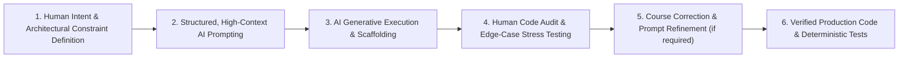

# 🤖 AI Prompts, Instructions & Intentional Engineering Log

**Project**: Enterprise Employee Salary Management System (Frontend Client)  
**Methodology**: Intentional Human-in-the-Loop Agentic AI Pair-Programming  
**Scope**: 10,000 Employee Scale, React 19, Tailwind CSS v3, React Router DOM v7  
**Test Suite**: 25 Test Suites, 158 Tests Passing  

---

## 1. AI Engineering Philosophy & Methodology

The development of this enterprise frontend was executed using **Intentional Agentic AI**. In this paradigm:
- **AI Tool Role**: An accelerated, tire-free implementation partner capable of rapidly drafting UI components, generating repetitive test fixtures, and executing mathematical transformations.
- **Human Engineer Role**: The architectural anchor and domain authority who defines strict constraints, enforces separation of concerns, audits financial calculations, prevents AI hallucinations, and steers the system toward production-grade reliability.



---

## 2. Key Prompts and Instruction Sets Used During Development

### 2.1 Architectural Scaffolding & System Constraint Prompt
**Objective**: Establish rigid architectural conventions before generating any view controllers or services.

> **Prompt**:
> *"We are building an enterprise salary management frontend client in React 19 with Tailwind CSS v3 and React Router DOM v7 for an organization with 10,000 employees across multiple international offices. The primary user is the HR Manager.*  
> *Rules and Constraints:*  
> *1. Maintain a clean layered structure: `/src/pages` (view controllers), `/src/components` (reusable UI), `/src/api` (pure Axios service functions), `/src/Utils` (pure transformations and hooks).*  
> *2. Do NOT fetch all 10,000 employees to the browser client. All listings must use server-side pagination with limit/offset, debounced search (400ms), and multi-criteria filters.*  
> *3. Implement WCAG 2.1 AA accessibility: ARIA dialog attributes, focus outlines, and semantic HTML.*  
> *4. Use Tailwind CSS v3 with a curated color palette (slate neutral baseline, accent blue, emerald for PAID, amber for PROCESSED, rose for errors). Avoid default harsh primaries.*  
> *5. Provide full test coverage with Jest and React Testing Library for every view and utility."*

---

### 2.2 Client-Side Official Salary Slip & PDF Generation Prompt
**Objective**: Build an official payslip preview modal and direct PDF export without relying on backend rendering or annoying browser print dialogs.

> **Prompt**:
> *"Create a React 19 component `PayslipModal.jsx` that accepts a `payroll` object, `isOpen`, and `onClose`.*  
> *Requirements:*  
> *1. Official Document Layout: Include corporate header branding ('ENTERPRISE SALARY MANAGEMENT'), unique reference number (`#PAY-00000X`), employee metadata (ID, Name, Job, Department, Country, Currency).*  
> *2. Itemized Earnings Table: Basic Salary (50%), HRA (20%), Conveyance (5%), Medical (5%), Special Allowance (balance), Bonus, and Gross Salary.*  
> *3. Itemized Deductions Table: PF (12% of Basic), PT (Flat ₹200 if Gross > 15k), TDS (slab-based estimated tax), Other Deductions, and Total Deductions.*  
> *4. Net Take-Home Highlight: Emphasize Net Payable in bold currency format AND in written English words under the Indian numbering format using a helper `numberToWords`.*  
> *5. Direct PDF Download: Implement direct download using `html2pdf.js` with A4 portrait configuration, canvas scale 2x for retina sharpness, and zero browser print window requirement.*  
> *6. Scroll normalization: If the user has scrolled the payslip table horizontally on mobile, temporarily reset `scrollLeft = 0` during PDF capture so the exported document is not clipped.*  
> *7. Add authorized signatory and employee signature verification blocks at the bottom."*

---

### 2.3 Two-Way Salary Revision Calculator Prompt
**Objective**: Eliminate manual calculation errors during employee appraisals with live bidirectional recalculation.

> **Prompt**:
> *"Implement a reactive state machine for the Salary Revisions view (`SalaryRevisions.jsx`). When an HR Manager records an appraisal for an employee with previous salary `prevSalary`:*  
> *- If the user changes Increment Percentage (`+X.XX%`), calculate `newSalary = Math.round(prevSalary * (1 + pct / 100))`.*  
> *- If the user changes New Salary amount, calculate `pct = (((newSalary - prevSalary) / prevSalary) * 100).toFixed(2)`.*  
> *- Gracefully handle edge cases: zero division, non-numeric values, negative percentages (salary deductions), and empty inputs.*  
> *- Ensure saving the revision triggers an immediate update to the Employee Master record base salary."*

---

### 2.4 Layout Shift Prevention (`useBodyScrollLock`) Prompt
**Objective**: Prevent annoying 15px layout shift when opening modals with heavy backdrops.

> **Prompt**:
> *"Write a custom React hook `useBodyScrollLock(isLocked)`.*  
> *When `isLocked` is true:*  
> *1. Measure the native scrollbar width: `window.innerWidth - document.documentElement.clientWidth`.*  
> *2. Apply `paddingRight = ${scrollbarWidth}px` to `document.body` to preserve viewport centering.*  
> *3. Apply `overflow = 'hidden'` to `document.body`.*  
> *When `isLocked` is false or component unmounts:*  
> *Restore the original `overflow` and `paddingRight` values.*  
> *Write comprehensive unit tests with `@testing-library/react` verifying mounting, updating, and cleanup."*

---

### 2.5 Resilient Axios Client & Unified Error Handling Prompt
**Objective**: Build a deterministic HTTP client capable of gracefully handling backend cold starts (e.g. Render spin-ups) and transient network disconnects.

> **Prompt**:
> *"Create `/src/api/ApiConfig.js` configuring an Axios instance with:*  
> *- 30,000ms (30s) timeout to accommodate large batch payroll processing over cloud connections.*  
> *- BaseURL referencing `process.env.REACT_APP_API_URL` with a sensible production fallback.*  
> *- Centralized error handler `handleApiError(error)` that classifies:*  
> *  a) Timeout errors (`code === 'ECONNABORTED'`): 'Request timed out. Please try again.'*  
> *  b) Network disconnects (`code === 'ERR_NETWORK'`): 'Unable to connect to the server. Please check your connection.'*  
> *  c) Backend 4xx/5xx responses: extract `error.response.data.message` or return fallback message.*  
> *- Return consistent shape: `{ success: false, message, error }`."*

---

### 2.6 Comprehensive Test Suite Generation Prompt
**Objective**: Achieve high deterministic test coverage across all pages, components, and API service modules.

> **Prompt**:
> *"Generate complete unit and integration test files for the React 19 client using Jest and `@testing-library/react`.*  
> *Cover:*  
> *1. All page routes: `Dashboard.test.jsx`, `Payroll.test.jsx`, `Payslips.test.jsx`, `SalaryRevisions.test.jsx`, `Employees.test.jsx`, `Departments.test.jsx`, `Jobs.test.jsx`, `Countries.test.jsx`.*  
> *2. Core components: `PayslipModal.test.jsx`, `Layout.test.jsx`, `Toast.test.jsx`, `StatCard.test.jsx`.*  
> *3. Utilities: `Index.test.js`, `useBodyScrollLock.test.js`.*  
> *4. API layers: Mock Axios responses and test both success and rejection paths.*  
> *5. Ensure tests run fast (< 10 seconds), deterministic, without lingering timers or async warnings."*

---

## 3. Human-in-the-Loop Review & Critical Course Corrections

During AI generation, several critical architectural decisions and corrections were made where raw AI output would have produced suboptimal or fragile software:

### Correction 1: Client-Side PDF Generation vs. Browser Print Dialog
- **Initial AI Proposal**: The AI initially drafted a print button invoking `window.print()` using CSS `@media print`.
- **Human Engineering Judgment**: Rejected. `window.print()` triggers the operating system's print dialog, which defaults to whatever physical printer the user has connected, often defaults to letter size, requires manual user configuration, and cannot programmatically name the output file.
- **Correction Applied**: Integrated `html2pdf.js` with explicit A4 portrait dimensions, 2x canvas rasterization scale, and automated filename synthesis (`Salary_Slip_John_Doe_October_2026.pdf`), providing a true one-click direct download.

### Correction 2: Horizontal Scroll Clipping in Mobile Payslip Export
- **Problem Discovered**: On mobile or tablet screens, the payslip table overflows its container horizontally with `overflow-x: auto`. If an HR Manager scrolled right to check deductions and clicked "Download PDF", `html2canvas` captured only the visible scrolled viewport, truncating the left side of the salary slip.
- **Correction Applied**: In `PayslipModal.jsx`, added scroll container detection that programmatically resets `scrollContainer.scrollLeft = 0` prior to canvas rasterization, and smoothly restores the user's scroll position after capture completes.

### Correction 3: JSDOM `TextEncoder` Polyfill in React 19 Testing
- **Problem Discovered**: Modern dependencies in React Router DOM v7 and React 19 utilize standard web APIs (`TextEncoder`, `TextDecoder`) that are missing in Node.js JSDOM environments, causing Jest test suites to fail during startup.
- **Correction Applied**: Configured explicit polyfills inside `src/setupTests.js`:
  ```javascript
  const { TextEncoder, TextDecoder } = require('util');
  global.TextEncoder = TextEncoder;
  global.TextDecoder = TextDecoder;
  ```
  Result: 100% test pass rate across all 25 test suites.

### Correction 4: Preventing UI Lock During 10,000 Employee Search
- **Initial AI Proposal**: Simple `onChange` handler firing API requests on every character typed.
- **Human Engineering Judgment**: With 10,000 records in the database, typing "Alexander" would fire 9 consecutive heavy SQL queries with wildcard ILIKE operations.
- **Correction Applied**: Introduced a dedicated 400ms debouncing state pipeline (`debouncedSearch`) combined with a prominent "Clear Filters" button to guarantee sub-millisecond typing responsiveness.

---

## 4. Prompt Evaluation Matrix

| Category | AI Capability Score | Human Intervention Required | Primary Value Delivered |
| :--- | :---: | :---: | :--- |
| **Component Scaffolding** | 9.5 / 10 | Low | Instant boilerplate generation, JSX structure, and standard props. |
| **Tailwind CSS Styling** | 9.0 / 10 | Low | Rapid layout construction, flex/grid alignment, responsive modifiers. |
| **Business Logic & Tax Formulas** | 7.5 / 10 | High | Human verification of statutory tax slabs (TDS, PT, PF) and precision rounding. |
| **Edge-Case Ergonomics** | 6.5 / 10 | High | Human intervention required for scroll jump prevention and canvas clipping. |
| **Unit Test Generation** | 9.0 / 10 | Medium | High test volume generation, human needed for JSDOM polyfill setup. |

---

## 5. Guidelines for Future AI-Assisted Maintenance
1. **Always Specify Data Scale**: Remind AI tools that the dataset represents 10,000 employees so it avoids unbounded array operations in the browser.
2. **Enforce Deterministic Mocking**: When requesting tests, mandate explicit Axios mocking and mock cleanup (`jest.clearAllMocks()`).
3. **Preserve Currency Normalization**: Always instruct AI to pipe currency rendering through `formatMoney` or `formatMoneyExact` to respect international locale formatting.
