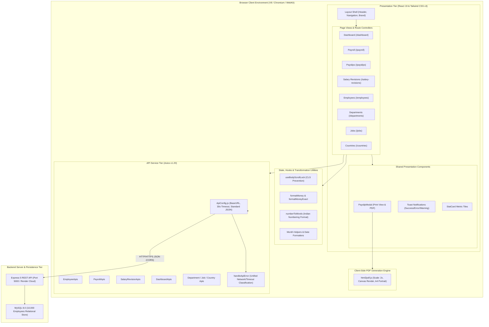
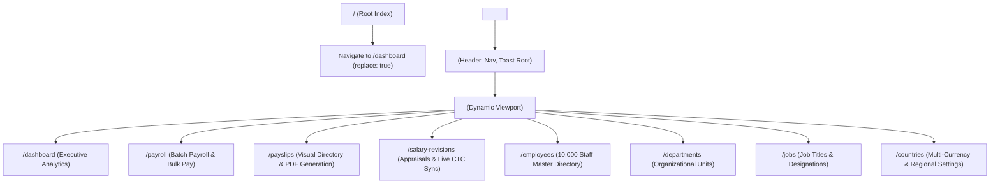
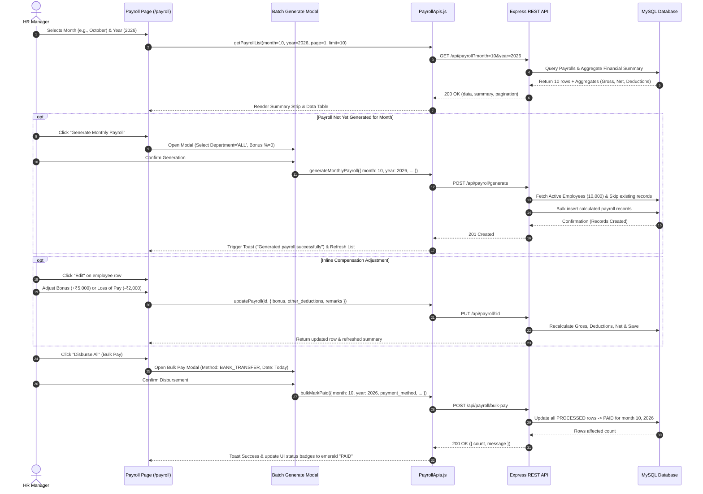
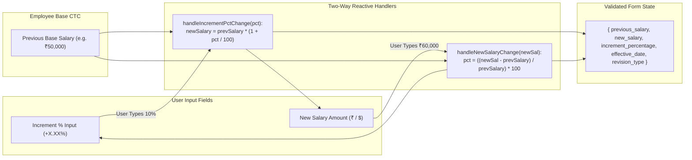
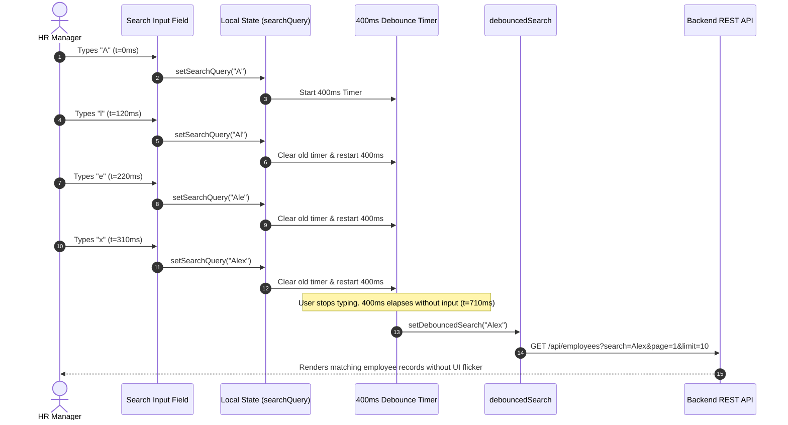
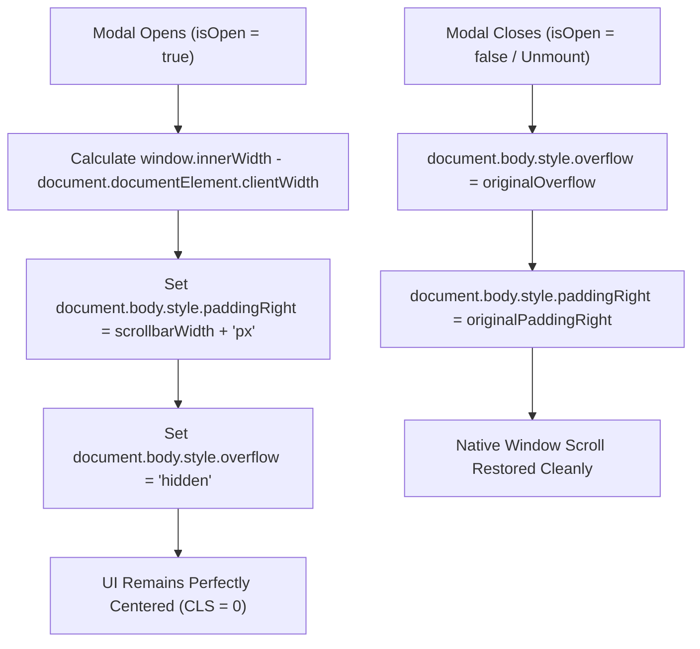

# 🏛️ Architecture and System Design Diagrams: Frontend Client

**Project**: Enterprise Employee Salary Management System (Frontend Client)  
**Target Organization**: Organization with 10,000 Employees across Multiple Regions  
**Primary User**: Human Resources (HR) Manager  
**Architecture Pattern**: Single Page Application (SPA) with Modular Layered Architecture  

---

## 1. High-Level Frontend System Architecture

The frontend application adopts a clean, layered architecture separating user interface presentation, application routing, state management, API services, and rendering utilities:

---

## 2. Application Routing & Layout Outlet Architecture (React Router v7)

The application utilizes React Router DOM v7's nested route architecture with an persistent layout shell:

---

## 3. End-to-End Monthly Payroll Processing & Disbursement Flow

This workflow illustrates how the HR Manager runs monthly payroll for 10,000 employees, adjusts bonuses/deductions, and marks records as paid:

---

## 4. Client-Side PDF Generation Engine (`html2pdf.js`)

Unlike traditional web applications that generate PDFs on the server (which bottlenecks CPU, requires Puppeteer / headless Chrome, and adds server storage costs), the frontend performs high-fidelity client-side rendering directly in browser memory:

```mermaid
flowchart TD
    UserTrigger["HR Manager clicks 'Download PDF' on Payslip Modal"]
    
    subgraph Step_1 ["1. Viewport & Scroll Normalization"]
        DetectScroll["Check if printable container is scrolled horizontally"]
        ResetScroll["Temporarily reset container scrollLeft = 0"]
        SetDownloadState["Set isDownloading = true (Disable buttons, show spinner)"]
    end

    subgraph Step_2 ["2. Target Element Isolation"]
        DOMQuery["Query #printable-payslip DOM node"]
        ApplyStyles["Verify inline printable CSS (Page-break rules, borders, colors)"]
        BuildFilename["Generate standard filename: Salary_Slip_<CleanName>_<Month>_<Year>.pdf"]
    end

    subgraph Step_3 ["3. Canvas Rasterization (html2canvas)"]
        CanvasConfig["Configure html2canvas: scale: 2 (Hi-DPI), useCORS: true, logging: false"]
        RenderCanvas["Rasterize target HTML element to High-Resolution Canvas"]
    end

    subgraph Step_4 ["4. PDF Composition (jsPDF)"]
        PDFConfig["Configure jsPDF: format: 'a4', orientation: 'portrait', unit: 'mm'"]
        SliceCanvas["Position canvas bitmap onto standard A4 printable margins [10mm]"]
        PageBreakMode["Enforce pagebreak: ['avoid-all', 'css', 'legacy'] to prevent row slicing"]
    end

    subgraph Step_5 ["5. Browser Direct Download & State Restoration"]
        SavePDF["Invoke browser native blob download (Zero browser print prompt)"]
        RestoreScroll["Restore original scrollLeft position"]
        ClearDownloadState["Set isDownloading = false"]
    end

    UserTrigger --> Step_1
    Step_1 --> Step_2
    Step_2 --> Step_3
    Step_3 --> Step_4
    Step_4 --> Step_5
```

---

## 5. Bidirectional Reactive State Flow: Salary Revision Calculator

When the HR Manager conducts performance appraisals or market corrections, they can enter either the desired percentage increment or the target monetary salary. The two inputs stay perfectly synchronized in real time:

---

## 6. Debounced Search & Query Pipeline (400ms Window)

To protect the backend from being hammered while the HR Manager searches through 10,000 employee records, a debounce pipeline sits between the raw input and the API query:

---

## 7. Modal Scroll Lock & Layout Shift Prevention Mechanism

---

## 8. Summary of Architectural Decisions

| Aspect | Architectural Choice | Benefit |
| :--- | :--- | :--- |
| **Framework** | React 19 SPA + React Router v7 | Instant client navigation, component composition, zero SSR latency for authenticated internal tools. |
| **Styling** | Tailwind CSS v3 | Highly maintainable utility tokens, zero runtime style injection, micro-bundle size (< 50KB). |
| **PDF Generation** | Direct Client `html2pdf.js` | Zero server CPU load, no Puppeteer dependencies, instant user file downloads. |
| **Data Fetching** | Axios Client with Centralized Error Interceptor | Deterministic 30s timeouts, unified user-friendly network error toasts. |
| **Scale Strategy** | Server-Side Slicing + Aggregates | Seamless UX on 10,000 employees without browser memory exhaustion. |
