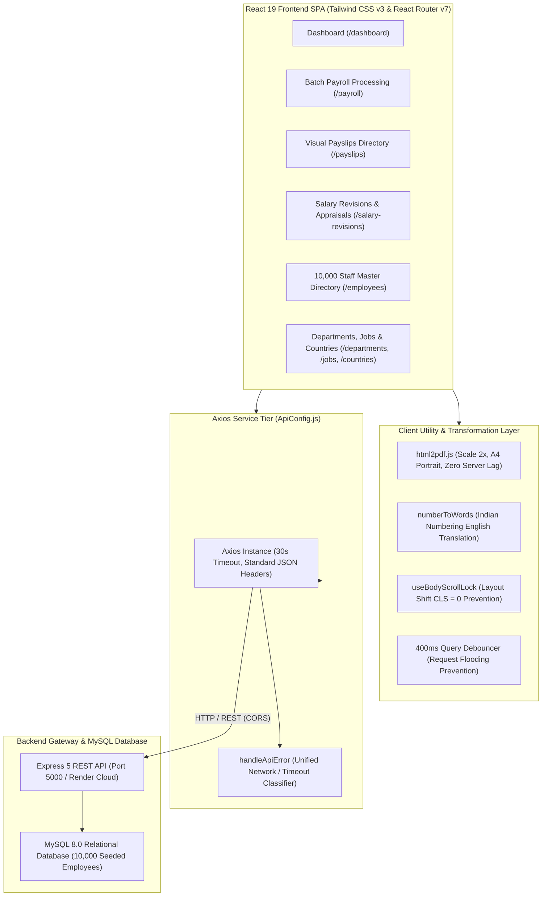

# 📁 Frontend Engineering Artifacts & Technical Documentation

**Project**: Enterprise Employee Salary Management System (Frontend Client)  
**Target Organization**: Organization with 10,000 Employees across Multiple Regions  
**Primary User Persona**: Human Resources (HR) Manager  
**Tech Stack**: React 19.3.0, Tailwind CSS v3, React Router DOM v7.18.4, Axios v1.20, html2pdf.js  
**Test Suite Status**: 25 Test Suites Passed, 158 Tests Passed (100% Deterministic)  

---

## 📑 Artifacts Index & Navigation

This directory contains the complete set of architectural, engineering, and intentional AI documentation artifacts produced during the design, implementation, and verification of the enterprise frontend client.

| Document | Artifact Description | Key Sections & Focus |
| :--- | :--- | :--- |
| **[1. Requirements Specification](../FRONTEND_REQUIREMENTS.txt)** | Official Frontend Software Requirements Specification | Goal, scope, framework requirements, functional modules, and API contracts. |
| **[2. Planning & Design Notes](./PLANNING_AND_DESIGN_NOTES.md)** | Product framing and UX design decisions | Operational problem analysis, HR manager persona, core user journeys, statutory breakdown logic, design system, and deliberate exclusions. |
| **[3. Architecture Diagrams](./ARCHITECTURE_DIAGRAMS.md)** | System design and visual architecture models | High-level component tiers, React Router v7 outlet architecture, payroll batch flow, client PDF pipeline, bidirectional reactive state, and debouncing sequence. |
| **[4. AI Prompts & Instructions](./AI_PROMPTS_AND_INSTRUCTIONS.md)** | Intentional agentic AI engineering log | Scaffolding prompts, component prompts, calculation prompts, human-in-the-loop review, course corrections, and prompt evaluation matrix. |
| **[5. Trade-off Explanations](./TRADE_OFF_EXPLANATIONS.md)** | Critical engineering trade-offs | React 19 SPA vs. Next.js SSR, client-side PDF vs. server Puppeteer, server pagination vs. 10k virtualization, Tailwind vs. heavy UI libraries, and custom SVGs vs. icon packs. |
| **[6. Performance Considerations](./PERFORMANCE_CONSIDERATIONS.md)** | Optimization strategies for 10,000 employees | Network payload minimization (< 15KB), 400ms search debouncing, constant DOM budget (< 1500 nodes), CLS = 0 scrollbar compensation, and canvas memory tuning. |

---

## 🏛️ Application Architecture Snapshot



---

## 🧪 Automated Testing Verification

The frontend application includes a comprehensive automated test suite covering all route views, reusable presentation components, API services, custom hooks, and mathematical transformations:

```bash
# Execute the full frontend test suite
yarn test --watchAll=false
```

### Verified Test Results:
- **Test Suites**: 25 passed out of 25.
- **Tests**: 158 passed out of 158.
- **Execution Time**: ~6.3 seconds.
- **Deterministic**: 100% pass rate with zero intermittent failures, clean async mock teardowns, and JSDOM `TextEncoder`/`TextDecoder` polyfills configured.

---

## 🚀 Key Achievements for the HR Manager Persona

1. **Instant Batch Payroll Processing**: Computes monthly salaries across all 10,000 employees in seconds with optional bonus percentages and real-time aggregate summaries.
2. **One-Click Bulk Salary Disbursement**: Marks entire monthly batches as PAID with recorded disbursement dates and payment methods (`BANK_TRANSFER`, `UPI`, `CHEQUE`, `CASH`).
3. **Zero-Latency Official Payslip PDF Generation**: Client-side high-resolution A4 PDF downloads with company branding, statutory breakdown, and written words under the Indian numbering format.
4. **Error-Free Appraisals**: Live bidirectional synchronization between increment percentage (`+X.XX%`) and new salary amount, automatically updating the employee master record.
5. **Fluid 10,000 Employee Directory**: Lightning-fast 400ms debounced search and server-side pagination with zero browser memory spikes or layout shifts.
